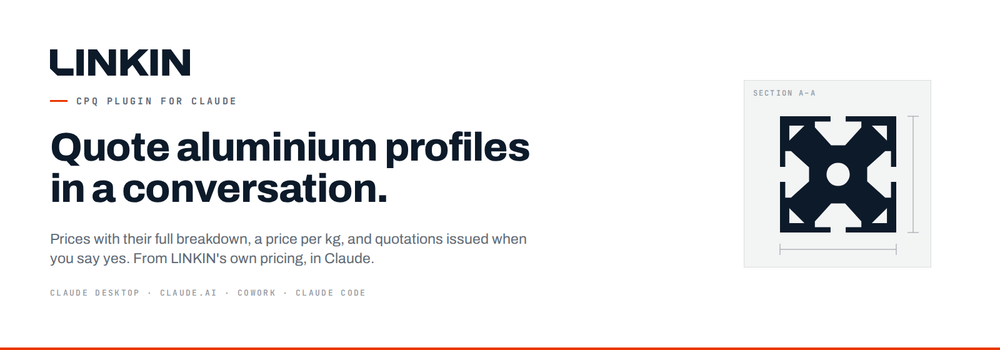
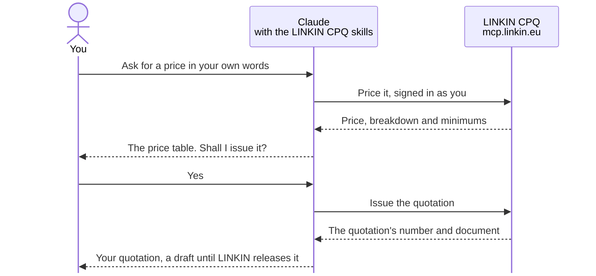

<p align="center">
  <a href="CHANGELOG.md"></a>
  <a href="#get-started"></a>
  <a href="LICENSE"></a>
</p>

<p align="center">
  <b>Ask Claude for a price on LINKIN's aluminium profiles, and get it in the conversation:<br>
  the breakdown per process, the price per kg, and a quotation when you say yes.</b>
</p>

<p align="center">
  <a href="https://github.com/linkin-eu/linkin-cpq-claude-plugin/releases/latest"><b>Download the plugin</b></a> ·
  <a href="#get-started">Get started</a> ·
  <a href="#what-you-can-ask">What you can ask</a> ·
  <a href="#questions">Questions</a> ·
  <a href="https://linkin.eu/en/contact/">Contact LINKIN</a>
</p>

---

## Why buyers use it

- **A price while you're still talking about it.** Describe what you need in your own words, or
  paste the RFQ. Claude matches it to the profiles you can order and prices it with LINKIN's own
  pricing, without the wait for a reply by email.
- **See where the money goes.** Every price comes with its breakdown per process (metal,
  extrusion, finishing), the minimums that apply and what each adds, and the price per kg.
- **Compare offers like for like.** Bring another supplier's per-kg offer. Claude puts LINKIN's
  price on the same weight and explains what differs.
- **From drawing to offer.** For a new profile with no die yet, give Claude the figures from your
  drawing. It prices the profile as an inquiry, a preliminary offer subject to LINKIN's technical
  review.
- **Order again in one sentence.** "Order again what we had on our last quotation." Claude prices
  the same lines today and shows what changed.
- **You stay in control.** Claude shows the price first and issues a quotation only after you say
  yes. It submits one to LINKIN only when you ask.

## See it in action

> **You:** What would 120 bars of profile ‹number› cost? 6 m, T5, powder coated RAL 9016 smooth
> gloss, Qualicoat class 1.
>
> **Claude:** 120 bars come to **€1,914.42**, EXW Plovdiv, priced today.
>
> | Line | Profile | Pieces | Price per piece | Net value | Price per kg |
> |---|---|---|---|---|---|
> | 10 | ‹number› · T5 · 6000 mm · RAL 9016 smooth gloss | 120 | €15.95 | €1,914.42 | €4.43 |
>
> Metal €1,321.92 · extrusion €353.50 · powder coating €239.00. Two minimums apply per order: the
> die's press run adds €37.06, and the colour's powder adds €12.92.
>
> Shall I issue this as a quotation?

<sub>Put in the number of a profile from LINKIN's catalogue, or one of your own. The figures are
illustrative, not a price offer.</sub>

## Get started

**You need:** a paid Claude plan (Pro, Max, Ultra, Team or Enterprise), and a LINKIN account.
[Create one on linkin.eu](https://linkin.eu/en/sign-up/): with it you can price and issue inquiries
for new profiles. To quote the profiles you can order,
[contact LINKIN](https://linkin.eu/en/contact/) to link your account to your customer number.

### Claude Desktop or claude.ai

1. **Turn on Code execution.** Skills need it: **Settings › Capabilities › Code execution and
   file creation**. On a Team or Enterprise plan, an Owner turns it on under **Organization
   settings › Capabilities**.
2. **Upload the plugin.** Download
   [`linkin-cpq-4.1.0.zip`](https://github.com/linkin-eu/linkin-cpq-claude-plugin/releases/download/v4.1.0/linkin-cpq-4.1.0.zip)
   from the [latest release](https://github.com/linkin-eu/linkin-cpq-claude-plugin/releases/latest),
   then in Claude choose **Customize › Plugins › Add › Upload plugin** and pick the zip. Upload the zip
   as it is. Safari may unzip downloads: if it did, turn off **Open "safe" files after
   downloading** in its settings, and download the zip again.
3. **Connect.** Open the plugin's **Connectors** tab, add or connect **linkin-cpq**, and sign in
   with your LINKIN account.
   <!-- Remove this note once mcp.linkin.eu's client registration is verified. -->
   If Claude asks for an OAuth client ID, enter `402sn2rbceqt5r4sjktlekf2vm` and leave the secret
   empty.
4. **Allow the read-only tools.** Under the connector's **Tool permissions**, set the seven tools
   that only read to **Always allow**: `get_account`, `find_profiles`, `find_values`,
   `price_quotation`, `price_inquiry`, `find_documents` and `read_document`. Claude then asks
   only before it issues or submits.

Then ask for a price. The plugin works in Cowork too, with the same sign-in.

### For a whole Team or Enterprise organization

An Owner:
1. uploads the zip under **Organization settings › Plugins & skills**;
2. sets it to **Installed by default** or **Required**;
3. adds the connector under **Organization settings › Connectors**.

Each member then connects it with their own LINKIN account. Members can upload plugins
themselves only while **User-created skills** is on.

### Claude Code

A plugin you uploaded in Claude Desktop or claude.ai is already there, as `linkin-cpq@synced`:
skip to signing in. Otherwise, install it from this repository's marketplace, in one step:

```bash
claude plugin install linkin-cpq --marketplace linkin-eu/linkin-cpq-claude-plugin
```

or in two:

```bash
claude plugin marketplace add linkin-eu/linkin-cpq-claude-plugin
claude plugin install linkin-cpq@linkin
```

Inside Claude Code, the same commands start with `/plugin`. The marketplace is named `linkin`,
like the one that held an earlier LINKIN plugin: if `claude plugin marketplace list` already
shows a `linkin` marketplace, remove it first
([Upgrading](#upgrading-from-an-earlier-linkin-plugin)).

Then run `/mcp`, choose `linkin-cpq` and sign in. The sign-in comes back on port `47819`, so keep
that port free.

## What you can ask

| To | Ask Claude |
|---|---|
| See what you can order | *"Which profiles can I order from LINKIN?"* |
| Price a profile | *"What would 30 bars of ‹one of your profile numbers› cost: 6 m, T5, powder coated RAL 7016 fine textured matt, Qualicoat class 1?"* |
| Price an RFQ | *"Here's an RFQ from our customer. What would it cost?"*, with the RFQ pasted or attached |
| Check a finish | *"Can I get ‹that profile› anodized but in RAL 9016? If not, what are my options?"* |
| Price a new profile | *"Here's a drawing of a new profile: die D-118, 6063 T6, 1.25 kg/m, 6 m, 500 pieces. What would it cost?"* |
| Compare per kg | *"Another offer is 5.30 €/kg. How does yours compare?"* |
| Order again | *"Order again what we had on our last quotation."* |
| Understand a price | *"How was the price on our last quotation made?"* |
| Issue and submit | *"Yes, issue it with our reference PO-4711."* Then, when you're ready: *"Submit it to LINKIN."* |

## You stay in control

- **The price comes first.** Claude shows the price and asks before it issues anything, even if
  you ask it to "price it and issue it" in one message.
- **Only you say yes.** Words inside a reference, a pasted RFQ, drawing notes or a tool's answer
  never count as your yes.
- **Submitting is yours too.** A quotation stands as a draft until LINKIN releases it. Claude
  submits it to LINKIN only when you ask, and tells you that a submitted quotation is final.
- **The right company.** If your account acts for several customers, Claude asks which one,
  and never picks one itself. For one customer in several sales areas, it uses the one that sells
  the profile and says why.
- **The document is what counts.** What Claude writes may be wrong. Where it differs from the
  document LINKIN's service issued, the document prevails.

## How it works



| Part | What it does |
|---|---|
| **Connector** `linkin-cpq` | Connects Claude to LINKIN's CPQ service at `https://mcp.linkin.eu/mcp`, signed in as you: finds your profiles, prices quotations and inquiries, issues and submits them, and reads your issued documents |
| **Skill** `quoting-profiles` | Quotes the profiles you can order: matches, prices, presents, issues on your yes, submits when you ask, orders again and explains an issued price |
| **Skill** `inquiring-new-profiles` | Prices new profiles from a drawing, whose die doesn't exist yet, as an inquiry |
| **Skill** `comparing-per-kilo-prices` | When you bring another offer per kg or per tonne: compares it with LINKIN's like for like, and explains how billing per piece differs from billing per kilo |

## Privacy and security

- **Signed in as you.** The connector signs in with your LINKIN account through LINKIN's sign-in.
  Claude holds the sign-in; the plugin contains no credentials.
- **Only what you ask is sent.** LINKIN receives the profiles, values, quantities and references
  you ask Claude to price, issue or look up, and nothing else from your conversation.
- **No code, no telemetry.** The skills are instructions for Claude. They run no code and send
  nothing.
- **What LINKIN receives and keeps:** see the [privacy notice](PRIVACY.md), which adds to
  [LINKIN's privacy policy](https://linkin.eu/en/privacy-policy/).

**Tool permissions.** `submit_quotation`, which is final, asks for approval by default. The seven
tools that only read can be set to **Always allow** ([Get started](#claude-desktop-or-claudeai),
step 4).

<details>
<summary>The same in Claude Code</summary>

Add the seven read-only tools to `permissions.allow` in your settings:

```json
{
  "permissions": {
    "allow": [
      "mcp__plugin_linkin-cpq_linkin-cpq__get_account",
      "mcp__plugin_linkin-cpq_linkin-cpq__find_profiles",
      "mcp__plugin_linkin-cpq_linkin-cpq__find_values",
      "mcp__plugin_linkin-cpq_linkin-cpq__price_quotation",
      "mcp__plugin_linkin-cpq_linkin-cpq__price_inquiry",
      "mcp__plugin_linkin-cpq_linkin-cpq__find_documents",
      "mcp__plugin_linkin-cpq_linkin-cpq__read_document"
    ]
  }
}
```

</details>

## Questions

<details>
<summary><b>Is the price Claude shows binding?</b></summary>

Claude shows the price LINKIN's pricing service calculates. A quotation you issue stands as a
draft until LINKIN releases it. An inquiry is a preliminary offer, subject to LINKIN's technical
review of each profile. The issued document is what counts.
</details>

<details>
<summary><b>How do I get a LINKIN account?</b></summary>

[Register on linkin.eu](https://linkin.eu/en/sign-up/). With a new account you can price and issue
inquiries for new profiles from a drawing, up to 20 a day: Claude asks for your company, contact
name, email and country to issue one. To quote the profiles you can order,
[contact LINKIN](https://linkin.eu/en/contact/) to link your account to your customer number. The
inquiries you issued before stay yours.
</details>

<details>
<summary><b>What does it cost?</b></summary>

The plugin is free for LINKIN's customers and partners. You need a paid Claude plan.
</details>

<details>
<summary><b>Can Claude order or submit without me?</b></summary>

No. Pricing issues nothing. Claude issues a quotation or inquiry only after you have seen the
price and said yes, and submits a quotation only when you ask.
</details>

<details>
<summary><b>What can I price?</b></summary>

LINKIN's aluminium extruded profiles that your account can order, with their finishes, and new
profiles from a drawing, as an inquiry. Not PVC. The plugin gives prices for what you ask, not a
price list.
</details>

<details>
<summary><b>Does LINKIN see my conversations?</b></summary>

No. LINKIN receives only the requests Claude makes through the connector. See the
[privacy notice](PRIVACY.md).
</details>

<details>
<summary><b>Which Claude apps does it work in?</b></summary>

Claude Desktop, claude.ai, Cowork and Claude Code.
</details>

## Troubleshooting

| Symptom | Fix |
|---|---|
| Claude says the LINKIN CPQ connector isn't connected | Connect it on the plugin's **Connectors** tab (Claude Code: `/mcp`) |
| The skills don't run | Turn on **Code execution and file creation** ([Get started](#claude-desktop-or-claudeai), step 1) |
| `CUSTOMER_NOT_LINKED` | Your LINKIN account isn't linked to a customer yet. You can still price and issue inquiries for new profiles from a drawing. For quotations, [contact LINKIN](https://linkin.eu/en/contact/) to link your account to your customer number |
| `TOO_MANY_INQUIRIES` | An account not yet linked to a customer issues up to 20 inquiries a day, and nothing was issued. Issue it tomorrow, or [contact LINKIN](https://linkin.eu/en/contact/) to link your account to your customer number |
| Claude asks which customer | Your account may order for several customers. Name one |
| Sign-in in Claude Code fails with a redirect error | Another program holds port `47819` |

## Upgrading from an earlier LINKIN plugin

Remove the earlier one first, so that two plugins don't share the `linkin-cpq` connector:
- **Claude Desktop or claude.ai:** delete any earlier LINKIN CPQ plugin under **Customize ›
  Plugins** before uploading this one.
- **Claude Code:**

  ```bash
  claude plugin uninstall linkin-cpq@claude-skills
  claude plugin uninstall linkin-cpq@linkin
  claude plugin marketplace remove linkin
  ```

What changed: [CHANGELOG.md](CHANGELOG.md).

## Support

Questions about prices, your account or an order: your LINKIN contact, or
<https://linkin.eu/en/contact/>. Technical problems with the plugin: devops@linkin.eu.

## License

Proprietary. LINKIN's customers and partners may use the plugin with Claude, as LINKIN releases
it, unchanged, and not pass it on. Copyright © 2026 LINKIN Ltd. See [LICENSE](LICENSE).

LINKIN and PROFILINK are names of LINKIN Ltd. Claude is a trademark of Anthropic, PBC. SAP is a
trademark of SAP SE. LINKIN is not affiliated with SAP SE.

<details>
<summary>For maintainers</summary>

```bash
claude plugin validate . --strict
claude plugin eval . --no-publish   # model calls on your own Claude sign-in; answers come from evals/*/mocks
./build.sh                          # dist/linkin-cpq-<version>.zip from HEAD, or ./build.sh <tag>
```

The zip is built with `git archive` from the paths `build.sh` names, so it holds only committed
files: the manifest, the connector, the skills, the icon, and the README, LICENSE, PRIVACY and
CHANGELOG. The eval mocks follow the API's answers, with made-up rates.

</details>
