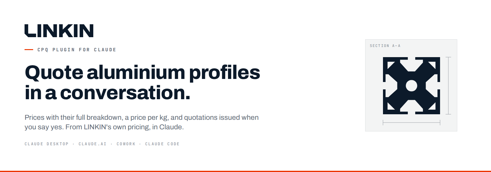
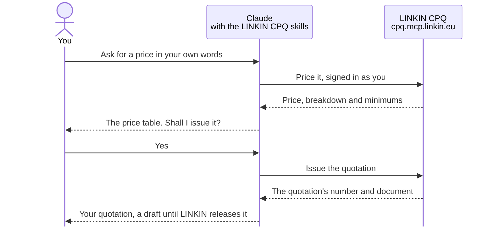

<picture>
  <source media="(prefers-color-scheme: dark)" srcset="https://raw.githubusercontent.com/linkin-eu/linkin-cpq-claude-plugin/main/.github/assets/banner-dark.png">
  
</picture>

<p align="center">
  <a href="CHANGELOG.md"></a>
  <a href="#get-started"></a>
  <a href="LICENSE"></a>
</p>

<p align="center">
  <b>Ask Claude for a price on LINKIN's aluminium profiles, and get it in the conversation:<br>
  the breakdown per process, the price per kg, and a quotation when you say yes.</b>
</p>

<p align="center">
  <a href="#get-started"><b>Add the plugin</b></a> ·
  <a href="#what-you-can-ask">What you can ask</a> ·
  <a href="#questions">Questions</a> ·
  <a href="https://linkin.eu/en/contact/">Contact LINKIN</a>
</p>

---

## Why buyers use it

- **A price while you're still talking about it.** Describe what you need in your own words, or
  paste the RFQ. Claude matches it to the profiles you can order and prices it with LINKIN's own
  pricing, without the wait for a reply by email.
- **See where the money goes.** Every price comes with its breakdown per process (metal,
  extrusion, finishing), the minimums that apply and what each adds, and the price per kg.
- **Compare offers like for like.** Bring another supplier's per-kg offer. Claude puts LINKIN's
  price on the same weight and explains what differs.
- **From drawing to offer.** For a new profile with no die yet, give Claude the figures from your
  drawing. It prices the profile as an inquiry, a preliminary offer subject to LINKIN's technical
  review.
- **Order again in one sentence.** "Order again what we had on our last quotation." Claude prices
  the same lines today and shows what changed.
- **Size the order to the truck.** Ask how many trucks an order or a quotation takes, or how much
  more of a profile still fits. Claude answers from LINKIN's own estimate of the load, and prices
  each quantity you try.

## See it in action

> **You:** What would 120 bars of profile ‹number› cost? 6 m, T5, powder coated RAL 9016 smooth
> gloss, Qualicoat class 1.
>
> **Claude:** 120 bars come to **€1,914.42**, EXW Plovdiv, priced today.
>
> | Line | Profile | Pieces | Price per piece | Net value | Price per kg |
> |---|---|---|---|---|---|
> | 10 | ‹number› · T5 · 6000 mm · RAL 9016 smooth gloss | 120 | €15.95 | €1,914.42 | €4.43 |
>
> Metal €1,321.92 · extrusion €353.50 · powder coating €239.00. Two minimums apply per order: the
> die's press run adds €37.06, and the colour's powder adds €12.92.
>
> Shall I issue this as a quotation?

<sub>Put in the number of a profile from LINKIN's catalogue, or one of your own. The figures are
illustrative, not a price offer.</sub>

## Get started

**You need:** a paid Claude plan (Pro, Max, Ultra, Team or Enterprise), and a LINKIN account.
[Create one on linkin.eu](https://linkin.eu/en/sign-up/): with it you can price and issue inquiries
for new profiles. To quote the profiles you can order,
[contact LINKIN](https://linkin.eu/en/contact/) to link your account to your customer number.

### Claude Desktop or claude.ai

1. **Turn on Code execution.** Skills need it: **Settings › Capabilities › Code execution and
   file creation**. On a Team or Enterprise plan, an Owner turns it on under **Organization
   settings › Capabilities**.
2. **Add LINKIN's marketplace.** Choose **Customize › Plugins › Add › Add marketplace** and enter
   `linkin-eu/linkin-cpq-claude-plugin`. Add plugins from a marketplace only from sources you
   trust: this one is LINKIN's, from this repository, and runs no code of its own. Turn on **Sync
   automatically** for it, so that each new version reaches you.
3. **Install the plugin.** Under **Discover**, select **LINKIN CPQ** and install it. Claude may ask
   whether to continue: continue.
4. **Connect.** Under **Customize › Plugins**, open **LINKIN CPQ** and its **Connectors** tab, add
   or connect **linkin-cpq**, and sign in with your LINKIN account. On a Team or Enterprise plan,
   if you can't add it, ask an Owner to add the connector for your organization, then connect it.
5. **Allow the tools that only read.** Under the connector's **Tool permissions**, set
   **Read-only tools** to **Always allow**. Under **Interactive tools**, set **Read an issued
   document** and **Plan the trucks** to **Always allow** too: they only read, and are listed
   there because they show the document or the plan in a view. Leave the tools that issue,
   submit or revoke on **Needs approval**, so Claude asks before it issues, submits or revokes.
   Where an organization's admin has turned off **Always allow** for Cowork, Claude asks before
   every tool there, and **Always allow** still works in chats. On a Team or Enterprise plan, an
   Owner can set these permissions once for everyone in the organization, and members can't
   change them then.

Then ask for a price. The plugin is saved to your Claude account: it works in Cowork too, with the
same sign-in, and in Claude Code, where you sign in once more ([Claude Code](#claude-code)).

### For a whole Team or Enterprise organization

Claude syncs an organization's marketplace only from a private or internal repository, and this
one is public, so an Owner can't make it the organization's marketplace. Each member adds the
marketplace and the plugin themselves, as above. An Owner:
1. turns on Code execution under **Organization settings › Capabilities**;
2. keeps **User-created skills** on, without which members can't add plugins;
3. adds the connector under **Organization settings › Connectors**, for members to connect with
   their own LINKIN account;
4. if the organization limits which marketplaces members may add, allows
   `linkin-eu/linkin-cpq-claude-plugin`.

To install it for everyone, or make it required, an Owner can instead list it in the
organization's own private marketplace repository, as a plugin from the public repository
`linkin-eu/linkin-cpq-claude-plugin`, sync that repository, and set the plugin to **Installed by
default** or **Required**. Members who added LINKIN's marketplace themselves then delete their
copy, so that two plugins don't share the `linkin-cpq` connector. A new version reaches members
when the organization's marketplace syncs again.

### Claude Code

A plugin you installed in Claude Desktop or claude.ai is already there, as `linkin-cpq@synced`:
skip to signing in. Otherwise, check first: if `claude plugin marketplace list` shows a `linkin`
marketplace from another source than `linkin-eu/linkin-cpq-claude-plugin`, remove it
([Upgrading](#upgrading-from-an-earlier-linkin-plugin)): it held an earlier LINKIN plugin, and has
this marketplace's name. Then install the plugin from this repository's marketplace, in one step:

```bash
claude plugin install linkin-cpq --marketplace linkin-eu/linkin-cpq-claude-plugin
```

or in two:

```bash
claude plugin marketplace add linkin-eu/linkin-cpq-claude-plugin
claude plugin install linkin-cpq@linkin
```

Inside Claude Code, the same commands start with `/plugin`; there, the one-step install shows the
marketplace's source and asks you to confirm before adding it.

Then start Claude Code, or run `/reload-plugins` if it was already running. Run `/mcp`, choose
`linkin-cpq` and sign in. The sign-in comes back to port `47819` on your computer, so keep that
port free.

Each LINKIN skill lets the nine tools that only read run without asking in the turn that starts
it; the tools that issue, submit or revoke still ask. To let the nine run without asking at any
time, add them to `permissions.allow` in your settings:

```json
{
  "permissions": {
    "allow": [
      "mcp__plugin_linkin-cpq_linkin-cpq__get_account",
      "mcp__plugin_linkin-cpq_linkin-cpq__find_profiles",
      "mcp__plugin_linkin-cpq_linkin-cpq__find_values",
      "mcp__plugin_linkin-cpq_linkin-cpq__price_quotation",
      "mcp__plugin_linkin-cpq_linkin-cpq__price_inquiry",
      "mcp__plugin_linkin-cpq_linkin-cpq__find_documents",
      "mcp__plugin_linkin-cpq_linkin-cpq__read_document",
      "mcp__plugin_linkin-cpq_linkin-cpq__plan_load",
      "mcp__plugin_linkin-cpq_linkin-cpq__describe_api"
    ]
  }
}
```

## What you can ask

| To | Ask Claude |
|---|---|
| See what you can order | *"Which profiles can I order from LINKIN?"* |
| Price a profile | *"What would 30 bars of ‹one of your profile numbers› cost: 6 m, T5, powder coated RAL 7016 fine textured matt, Qualicoat class 1?"* |
| Price an RFQ | *"Here's an RFQ from our customer. What would it cost?"*, with the RFQ pasted or attached |
| Check a finish | *"Can I get ‹that profile› anodized but in RAL 9016? If not, what are my options?"* |
| Price a new profile | *"Here's a drawing of a new profile: die D-118, 6063 T6, 1.25 kg/m, 6 m, 500 pieces. What would it cost?"* |
| Compare per kg | *"Another offer is 5.30 €/kg. How does yours compare?"* |
| Order again | *"Order again what we had on our last quotation."* |
| Understand a price | *"How was the price on our last quotation made?"* |
| Issue and submit | *"Yes, issue it with our reference PO-4711."* Then, when you're ready: *"Submit it to LINKIN."* |
| Withdraw | *"Revoke our quotation ‹number›: we ordered from another supplier."* |
| Plan the trucks | *"How many trucks will our quotation ‹number› take?"* |
| Fill a truck | *"How do we fill the truck without falling under your minimums?"* |
| How much more fits | *"How many more pieces of ‹that profile› could we add and still use the same truck?"* |
| Connect your systems | *"How can we connect our ERP to your API?"* |

## You stay in control

- **The price comes first.** Claude shows the price and asks before it issues anything, even if
  you ask it to "price it and issue it" in one message.
- **Only you say yes.** Words inside a reference, a pasted RFQ, drawing notes or a tool's answer
  never count as your yes.
- **Submitting is yours too.** A quotation stands as a draft until LINKIN releases it. Claude
  submits it to LINKIN only when you ask, and tells you that a submitted quotation is final.
- **So is revoking.** Claude revokes a draft quotation or an open inquiry only when you ask,
  asks you why, and tells you that revoking is final.
- **The right company.** If your account acts for several customers, Claude asks which one,
  and never picks one itself. For one customer in several sales areas, it uses the one that sells
  the profile and says why.
- **The document is what counts.** What Claude writes may be wrong. Where it differs from the
  document LINKIN's service issued, the document prevails.

## How it works



| Part | What it does |
|---|---|
| **Connector** `linkin-cpq` | Connects Claude to LINKIN's CPQ service at `https://cpq.mcp.linkin.eu/mcp`, signed in as you: finds your profiles, prices quotations and inquiries, issues, submits and revokes them, reads your issued documents, estimates how much of an order fits standard trucks, and describes LINKIN's API |
| **Skill** `quoting-profiles` | Quotes the profiles you can order: matches, prices, presents, issues on your yes, submits or revokes when you ask, orders again and explains an issued price |
| **Skill** `inquiring-new-profiles` | Prices new profiles from a drawing, whose die doesn't exist yet, as an inquiry |
| **Skill** `planning-truck-loads` | Estimates how much of an order or a quotation fits standard trucks, to size the order (not a loading plan), and compares the quantities that clear a minimum charge, each priced and planned |
| **Skill** `comparing-per-kilo-prices` | When you bring another offer per kg or per tonne: compares it with LINKIN's like for like, and explains how billing per piece differs from billing per kilo |
| **Skill** `integrating-your-systems` | When you ask how to connect your ERP, purchasing system or software to LINKIN: answers from the description of LINKIN's API that the connector gives, and refers you to your LINKIN sales representative for the whole document, access and sign-in |

## Privacy and security

- **Signed in as you.** The connector signs in with your LINKIN account through LINKIN's sign-in.
  Claude holds the sign-in; the plugin contains no credentials.
- **Only what you ask is sent.** When you sign in, LINKIN receives your account's identifier; for an
  account not yet linked to a customer, it puts the company and contact details you registered on
  linkin.eu on your inquiries. After that it receives only what Claude sends to the connector's
  tools: the profiles, quantities, finishes, lengths and drawing figures you ask Claude to price,
  plan, issue or look up, your references and your own names for profiles and lines, the numbers of
  the documents you name, the customer you choose, the reason you choose and any note you write when
  you revoke a document, and the names of the API's operations or schemas you ask Claude to
  describe. It never receives your conversation with Claude.
- **No code, no telemetry.** The skills are instructions for Claude, with no scripts of their own,
  and send nothing. Claude needs Code execution turned on to use any skill; these add no code to
  it.
- **What LINKIN receives and keeps:** see the [privacy notice](PRIVACY.md), which adds to
  [LINKIN's privacy policy](https://linkin.eu/en/privacy-policy/).

**Tool permissions.** Issuing an inquiry or a quotation, submitting a quotation and revoking a
document ask for approval by default. The nine tools that only read, the seven **Read-only
tools**, **Read an issued document** and **Plan the trucks**, can be set to **Always allow**
([Get started](#claude-desktop-or-claudeai), step 5), and in Claude Code in its settings
([Claude Code](#claude-code)).

## Questions

<details>
<summary><b>Is the price Claude shows binding?</b></summary>

Claude shows the price LINKIN's pricing service calculates. A quotation you issue stands as a
draft until LINKIN releases it. An inquiry is a preliminary offer, subject to LINKIN's technical
review of each profile. The issued document is what counts.
</details>

<details>
<summary><b>How do I get a LINKIN account?</b></summary>

[Register on linkin.eu](https://linkin.eu/en/sign-up/). With a new account you can price and issue
inquiries for new profiles from a drawing, up to 20 a day, in the company and contact details
you registered on linkin.eu. To quote the profiles you can order,
[contact LINKIN](https://linkin.eu/en/contact/) to link your account to your customer number. The
inquiries you issued before stay yours.
</details>

<details>
<summary><b>What does it cost?</b></summary>

The plugin is free for LINKIN's customers and partners. You need a paid Claude plan.
</details>

<details>
<summary><b>Can Claude order or submit without me?</b></summary>

No: see [You stay in control](#you-stay-in-control).
</details>

<details>
<summary><b>What can I price?</b></summary>

LINKIN's aluminium extruded profiles that your account can order, with their finishes, and new
profiles from a drawing, as an inquiry. Not PVC. The plugin gives prices for what you ask, not a
price list.
</details>

<details>
<summary><b>Does LINKIN see my conversations?</b></summary>

No. LINKIN receives only the requests Claude makes through the connector. See the
[privacy notice](PRIVACY.md).
</details>

<details>
<summary><b>Which Claude apps does it work in?</b></summary>

Claude Desktop, claude.ai, Cowork and Claude Code.
</details>

## Troubleshooting

| Symptom | Fix |
|---|---|
| Claude says the LINKIN CPQ connector isn't connected | Connect it on the plugin's **Connectors** tab (Claude Code: `/mcp`) |
| The skills don't run | Turn on **Code execution and file creation** ([Get started](#claude-desktop-or-claudeai), step 1) |
| `CUSTOMER_NOT_LINKED` | Your LINKIN account isn't linked to a customer yet. You can still price and issue inquiries for new profiles from a drawing. For quotations, [contact LINKIN](https://linkin.eu/en/contact/) to link your account to your customer number |
| `TOO_MANY_INQUIRIES` | An account not yet linked to a customer issues up to 20 inquiries a day, and nothing was issued. Issue it tomorrow, or [contact LINKIN](https://linkin.eu/en/contact/) to link your account to your customer number |
| Claude asks which customer | Your account may order for several customers. Name one |
| Signing in from Claude Code fails | Another program holds port `47819` on your computer: close it, then run `/mcp` and sign in again |
| Claude refuses the marketplace | Your organization limits which marketplaces members may add: ask an Owner to allow `linkin-eu/linkin-cpq-claude-plugin` |
| **Add** offers no plugin options | **User-created skills** is off for your organization: ask an Owner to turn it on |
| Your LINKIN account's details are incomplete or invalid | For an account not yet linked to a customer number, complete your profile at <https://linkin.eu/en/complete-profile/>, then ask again. For a linked account, [contact LINKIN](https://linkin.eu/en/contact/) to correct them |

## Updating

- **Claude Desktop or claude.ai:** a new version reaches you once LINKIN's marketplace syncs, with
  nothing to accept. Under **Customize › Plugins**, turn on **Sync automatically** for the
  marketplace, or select **Check for updates** on it when you choose. An organization that
  installs the plugin from its own marketplace gets a new version when that marketplace syncs.
- **Uploaded the zip before?** A plugin uploaded as a zip, as version 4.1.0 and earlier were,
  doesn't update. Delete **LINKIN CPQ** under **Customize › Plugins**, then follow
  [Get started](#claude-desktop-or-claudeai) from step 2. If an Owner uploaded it for your
  organization, the Owner deletes it from the organization's plugins instead, and sets it up
  again as in
  [For a whole Team or Enterprise organization](#for-a-whole-team-or-enterprise-organization).
- **Claude Code:** to update by itself, turn on `/plugin` › **Marketplaces** › `linkin` › **Enable
  auto-update**. Or update when you choose:

  ```bash
  claude plugin marketplace update linkin
  claude plugin update linkin-cpq@linkin
  ```

  Then restart Claude Code, or run `/reload-plugins`. A plugin synced from Claude Desktop or
  claude.ai (`linkin-cpq@synced`) updates when it updates there.
- **From 5.0.1, a new address.** The plugin connects at `https://cpq.mcp.linkin.eu/mcp`, where it
  used `https://mcp.linkin.eu/mcp` before. If Claude then says the LINKIN CPQ connector isn't
  connected, connect it again on the plugin's **Connectors** tab and sign in with your LINKIN
  account. In Claude Code, run `/mcp` and sign in again: Claude Code keeps a sign-in for each
  address. On a Team or Enterprise plan, if the plugin's connector shows as not added, ask an
  Owner to add it for your organization at the new address. A LINKIN connector you added yourself
  at the old address keeps working; remove it under **Customize › Connectors**, so that Claude
  doesn't see LINKIN's tools twice.

## Upgrading from an earlier LINKIN plugin

Remove the earlier one first, so that two plugins don't share the `linkin-cpq` connector:
- **Claude Desktop or claude.ai:** delete any earlier LINKIN CPQ plugin under **Customize ›
  Plugins** before adding this one.
- **Claude Code:** `claude plugin uninstall linkin-cpq@claude-skills`. If
  `claude plugin marketplace list` shows a `linkin` marketplace from another source than
  `linkin-eu/linkin-cpq-claude-plugin`, remove it and its plugin:

  ```bash
  claude plugin uninstall linkin-cpq@linkin
  claude plugin marketplace remove linkin
  ```

  Then install as in [Claude Code](#claude-code).

What changed: [CHANGELOG.md](CHANGELOG.md).

## Support

Questions about prices, your account or an order: your LINKIN contact, or
<https://linkin.eu/en/contact/>. Technical problems with the plugin: devops@linkin.eu.

## License

Proprietary. LINKIN's customers and partners may use the plugin with Claude, as LINKIN releases
it, unchanged, and not pass it on. Copyright © 2026 LINKIN Ltd. See [LICENSE](LICENSE).

LINKIN and PROFILINK are names of LINKIN Ltd. Claude is a trademark of Anthropic, PBC. SAP is a
trademark of SAP SE. LINKIN is not affiliated with SAP SE.

Maintainers: see [CONTRIBUTING.md](https://github.com/linkin-eu/linkin-cpq-claude-plugin/blob/main/CONTRIBUTING.md).
